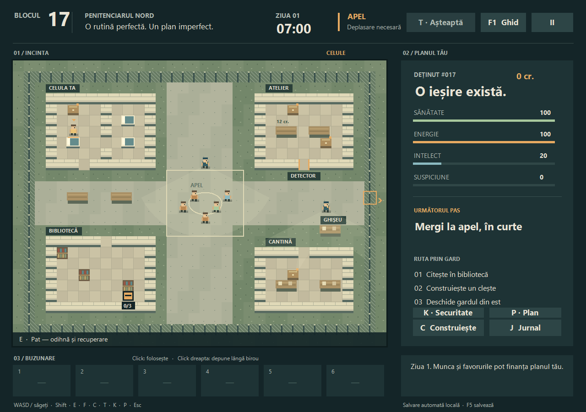
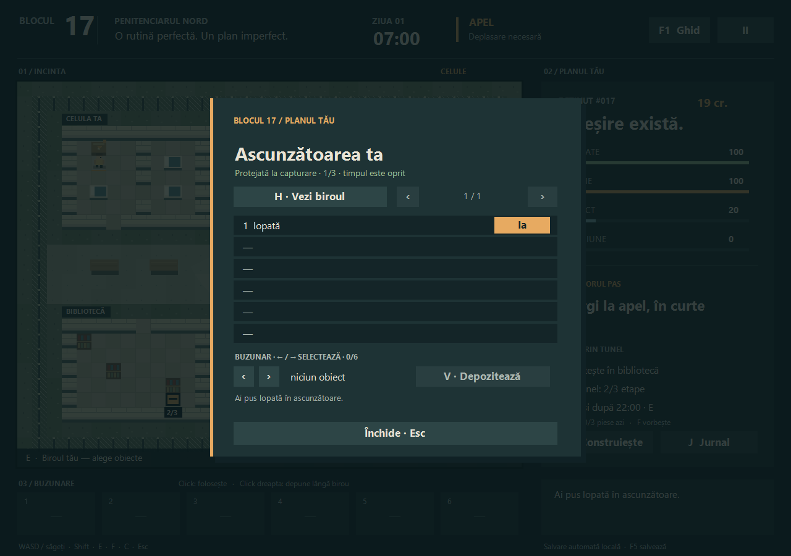

# Blocul 17

[](https://github.com/ValentinBold/blocul17/actions/workflows/ci.yml)
[](https://github.com/ValentinBold/blocul17/releases/latest)
[](LICENSE)

Joc original de evadare pentru **Windows**, în română. Studiază rutina închisorii, lucrează, fă favoruri și pregătește o ieșire prin gard sau prin tunel.

**[Descarcă jocul din Releases](https://github.com/ValentinBold/blocul17/releases/latest)** · [Raportează un bug](https://github.com/ValentinBold/blocul17/issues/new/choose) · [Istoric versiuni](CHANGELOG.md)



## Cum joci

1. Din ultima versiune, descarcă arhiva `Blocul17_Windows_v….zip` din **Assets**. Arhivele automate „Source code” conțin sursele, nu jocul compilat.
2. Extrage arhiva și deschide `Blocul17.exe`.
3. Folosește **WASD**, **E** pentru interacțiuni, **F** pentru conversații și **C** pentru unelte. **F1** deschide ghidul.

Nu necesită instalare, browser sau internet pentru joc. Folosește .NET Framework 4.x și Windows Forms. Executabilul este nesemnat și nu cere drepturi de administrator. Versiunea curentă este un prototip; vezi [verificările și limitele](VERIFICARE.md).

## Ce include 0.4.1

- Închisoare originală, patrule cu vedere și urmărire, program zilnic.
- Inventar, recipiente cu alegerea obiectelor și ascunzătoare protejată de trei locuri.
- Studiu, crafting, muncă plătită, favoruri și comerț.
- Evadare prin gard sau printr-un tunel fix cu ieșire nocturnă.
- Salvare locală și import al salvărilor 0.1–0.3.



## Actualizări și salvări

Versiunile noi apar în **Releases**, cu note despre schimbări și un ZIP Windows. Jocul nu are actualizator automat: descarci și extragi noua versiune într-un dosar separat. Poți urmări repository-ul prin **Watch → Custom → Releases**.

Salvarea 0.4 se află în `%LOCALAPPDATA%\Blocul17\save-v4.xml`. Dacă lipsește, jocul încearcă importul din `save-v3.xml`, `save-v2.xml`, apoi `save.xml`, fără modificarea originalului. Nu există import invers. Închide jocul înainte de a schimba versiunea și păstrează o copie a salvării dacă vrei să revii ulterior.

## Dezvoltare

Ai nevoie de Windows și compilatorul .NET Framework 4.x disponibil în `Windows\Microsoft.NET\Framework64`. Nu sunt necesare pachete NuGet.

```powershell
.\build.ps1
.\test.ps1
.\package.ps1
```

`test.ps1` compilează și rulează verificările motorului, cele trei trasee complete și o probă Windows Forms ascunsă. Jurnalele și imaginile se generează în `qa/`. Testarea automată nu înlocuiește verificarea manuală pe alte calculatoare.

`package.ps1` testează înainte să genereze ZIP-ul și hash-urile SHA-256. Exportul local implicit: `D:\04_DOWNLOADS\Blocul17_GitHub_Releases`. În CI se folosește un dosar temporar.

Pentru schimbări: [CONTRIBUTING.md](CONTRIBUTING.md). Pentru lansarea unei versiuni: [RELEASING.md](RELEASING.md). Pentru mecanici: [DESIGN.md](DESIGN.md), [ghidul jucătorului](CITESTE_MA.txt).

## Proveniență și licență

Proiect independent, inspirat de genul jocurilor de evadare și de The Escapists; nu este afiliat cu autorii jocului comercial. Harta, grafica procedurală și regulile acestui prototip sunt proprii. Nu include resurse comerciale, cod upstream, hărți comerciale sau binare J2ME.

Codul și grafica procedurală sunt publicate sub [licența MIT](LICENSE). Fișierele din `fixtures/` sunt salvări sintetice pentru teste, nu salvări personale.
